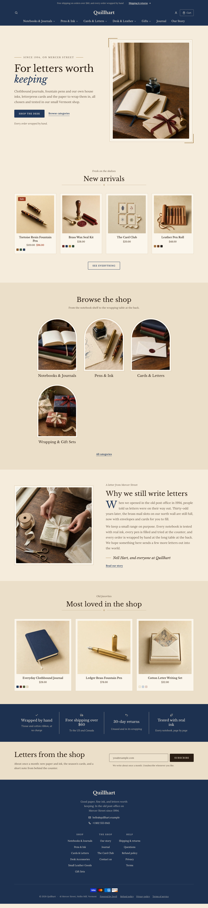

# Mooring

Mooring is a free storefront theme for **Wave**, the Swell storefront app with a visual editor and an AI agent. It is classic and warm: serif type throughout, a parchment ground with cream cards, a deep navy header and footer, brass details and photos in picture frames. It fits any kind of store.

- Listing copy (the Swell Theme Store page): [`DESCRIPTION.md`](DESCRIPTION.md)
- The installable theme app: [`app/`](app)

## Using it

1. Install Mooring from the Swell Theme Store. It is free.
2. Customize it in the Wave editor: click any section or line of text to change it, set fonts, colors, spacing and Mooring's own settings in the Theme tab, or ask the AI agent for a change in plain words.
3. Publish when it's ready. Until then every change stays a draft.

Mooring reads the store's own Swell data (products, categories, menus, the blog and store details), so set those up in the Swell dashboard first. Shoppers check out on Swell's hosted checkout.

## What's inside

Mooring is the classic and warm one of Swell's free themes; it changes the look, not the store's structure. Its own sections:

- `framed_hero`: the home page opening: words beside a framed photo (the top category's image until one is set)
- `featured_products`: products on cream cards under a centered title
- `collection_shelf`: categories in arch-topped or square frames
- `story_split`: a note from the shop, set like a letter with a large first letter and a sign-off
- `promise_band`: up to four short promises on a navy band
- `collection_intro`: a category's centered title page: framed banner, name, description, subcategory links
- `product_catalog`: a category's products with a Browse and Refine sidebar on wide screens
- `product_page`: the product page: framed photo and thumbnails, details on a cream card, folds below

Its own templates are home, product and collection; its own Header and Footer groups set both in navy. Its theme settings (`theme/config/settings_content.json`) cover: a sticky header; cards' second photo on hover, color dots, sale and sold-out tags and add button; the quantity box. Its colors, fonts and style choices are in `theme/config/settings.json`.

## How it's built

Mooring is built on Swell's shared theme core, like every Wave theme. The core provides the sections every theme has (header, footer, cart, account, search, blog, policies and the rest) and Store text, and every theme must show a Header and a Footer group on every page; Mooring adds its own sections, templates, settings and design over it. `app/` is the assembled theme, built from the core and the files here; change Mooring's own files and rebuild it, never edit `app/` by hand.

How a section is written, the repository layout and how a theme is assembled are the same for every theme on the core: see the README of Tide, Swell's first free theme.

## License

Mooring is licensed under the Swell App License (`LICENSE`), which covers this repository, the shared theme core in `app/` included.
